# Laporan Analitik & Eksperimen 12 Tahap Operasional: Deteksi Penipuan Transaksi (*Fraud Detection*)
**Mata Kuliah:** Machine Learning (UTS — Task 2: Classification)  
**Periode Evaluasi Uji:** September – Oktober 2025  
**File Submisi Utama:** `prediksi_klasifikasi.csv`  
**Panduan Kerja Acuan:** `blueprint_12_tahap_fraud_detection_task_2_uts.md`

---

## Ringkasan Eksekutif (*Executive Summary*)

Laporan ini menyajikan hasil perancangan, eksperimen komparatif, dan implementasi sistem deteksi penipuan transaksi (*fraud detection*) berskala produksi sesuai dengan **Blueprint 12 Tahap Operasional** dan rubrik penilaian UTS Machine Learning (Soal 2a–2g).

Sistem deteksi penipuan dirancang untuk menjawab tantangan operasional perbankan digital nyata:
1. **Ketimpangan Kelas Ekstrem (*Severe Class Imbalance*):** Proporsi kasus penipuan hanya sebesar **0,6505%** (2.622 kasus dari 403.077 transaksi).
2. **Keterlambatan Pelaporan (*Delayed Labels / Right-Censoring*):** Adanya investigasi dan sengketa transaksi (*chargeback delay*) yang menyebabkan transaksi di akhir periode latih tampak tidak ada penipuan (0% *fraud* pada 3 hari terakhir Agustus 2025).
3. **Risiko Kebocoran Informasi (*Target Leakage*):** Kolom tindakan operasional pasca-transaksi (`flag_review_manual`) yang harus dieliminasi demi validitas deployment masa depan.
4. **Optimasi Biaya Finansial Riil (*Cost Function*):** Keputusan penandaan transaksi manual (`tandai = 1`) berbiaya tetap **Rp 25.000**, sedangkan penipuan yang lolos (`is_fraud = 1` dan `tandai = 0`) merugikan sebesar **nilai nominal transaksi**.

### Rangkuman Metrik Utama (Lipatan Validasi OOT):
* **Performa Pemeringkatan Risiko (PR-AUC):** Ensemble terkalibrasi (**80% XGBoost + 20% CatBoost**) mencapai PR-AUC sebesar **0,6040** dan Log-Loss **0,01490**, jauh mengungguli model *linear baseline* (PR-AUC 0,4315) dan *LightGBM* (PR-AUC 0,4017).
* **Efisiensi Finansial (Total Cost):** Berhasil menekan total kerugian dari **Rp 250.166.288** (*baseline* tanpa deteksi / semua lolos) menjadi **Rp 42.182.400** pada ambang batas optimal ($\alpha = 0,5$), menghasilkan **penghematan finansial riil sebesar Rp 207.983.888 (83,14%)**.
* **Kepatuhan Submisi Data Uji:** Menghasilkan file `prediksi_klasifikasi.csv` sebanyak tepat **106.674 baris** untuk periode September–Oktober 2025 dengan rata-rata probabilitas $0,00851$, menandai **3.364 transaksi (3,1535%)** untuk tinjauan manual (kebutuhan anggaran review: **Rp 84.100.000**), dan mematuhi 100% batasan ekonomi mutlak ($0$ transaksi ber-nominal $\le \text{Rp } 25.000$ ditandai).

---

## Peta Keselarasan 12 Tahap terhadap Rubrik Laporan (`2a`–`2g`)

| Tahap Operasional | Sub-Bab Laporan | Rubrik Penilaian | Fokus Utama & Temuan Kunci |
| :--- | :--- | :--- | :--- |
| **Tahap 1 & 2** | Bab 1 & Bab 2 | Pendahuluan & Profil Data | Penguncian SEED 42, verifikasi skema, dan rasio kerugian fraud (48,4x biaya review). |
| **Tahap 3** | Bab 3 | **Soal 2a** – Audit Label & Fitur | Investigasi *delayed labels* (embargo 21 hari) & bukti kebocoran `flag_review_manual` (drop PR-AUC 0,1099). |
| **Tahap 4** | Bab 4 | **Soal 2b** – Validasi Waktu | *Out-of-Time split* (Juli–Agu 2025) & *purge gap* 3 hari untuk mencegah *look-ahead leakage*. |
| **Tahap 5** | Bab 5 | **Soal 2c** – Fitur Perilaku | 114 fitur *velocity*, deviasi nominal, *wallet drain*, ATO, dan *causal expanding target encoding*. |
| **Tahap 6 & 7** | Bab 6 & Bab 7 | **Soal 2d** – Model & Imbalance | Evaluasi 4 model (XGBoost terbaik PR-AUC 0,5841) & perbandingan 3 pendekatan imbalance. |
| **Tahap 8** | Bab 8 | **Soal 2e** – *Pattern Shift* | Eliminasi fitur drift ekstrem `v15` (KS 0,5055) & keunggulan *Expanding/Time-Decay* vs *Sliding*. |
| **Tahap 9 & 10** | Bab 9 & Bab 10 | **Soal 2f** – Kalibrasi & Biaya | Kalibrasi Isotonic Regression, penurunan matematis aturan biaya $\tau_i = \alpha \cdot \frac{25.000}{N_i}$, hemat 83,14%. |
| **Tahap 11** | Bab 11 | **Soal 2g** – Analisis Error | Bedah FP/FN per kanal (QRIS kerugian FN tertinggi), per nominal bracket, & *feature importance*. |
| **Tahap 12** | Bab 12 | Submisi & Rekomendasi | Generasi `prediksi_klasifikasi.csv`, verifikasi 4 uji sanitasi, & arsitektur *decisioning* produksi. |

---

## Bab 1: Tahap 1 — Persiapan Lingkungan, Reproducibility & Inspeksi Skema Awal

### 1.1 Standar Reproducibility & Lingkungan Komputasi
Seluruh tahapan pipeline dibangun dengan jaminan reproduksibilitas penuh (*one-command deterministic reproducibility*). Parameter acak dikunci menggunakan `SEED = 42` pada modul `numpy`, `random`, `lightgbm`, `xgboost`, `catboost`, dan `scikit-learn`.

Spesifikasi pustaka utama yang diverifikasi saat runtime:
* **Python**: `3.14.3`
* **NumPy**: `2.5.5` | **Pandas**: `3.1.1` | **Scikit-Learn**: `1.9.1`
* **LightGBM**: `4.7.0` | **XGBoost**: `3.4.1` | **CatBoost**: `1.2.10`

### 1.2 Verifikasi Skema & Kunci Primer
Pemuatan data dari `klasifikasi_train.csv` (403.077 baris, 85 kolom) dan `klasifikasi_test.csv` (106.674 baris, 84 kolom) dilakukan dengan downcasting tipe data (`float32` dan integer terpadat) untuk efisiensi memori (penggunaan RAM berkurang dari ~600 MB menjadi ~266 MB).
* **Audit Kunci Primer:** Kolom `id_transaksi` diverifikasi memiliki **0 duplikasi** pada kedua dataset.
* **Rentang Kronologis:**
  * Data Latih: `2025-01-01 00:02:53` s.d. `2025-08-31 23:58:04` (8 bulan penuh).
  * Data Uji: `2025-09-01 00:01:51` s.d. `2025-10-31 23:57:22` (2 bulan masa depan).

---

## Bab 2: Tahap 2 — Eksplorasi Data Awal (EDA) & Profil Ketimpangan Kelas

### 2.1 Distribusi Target & Karakteristik Nominal
Dari 403.077 transaksi latih, hanya terdapat **2.622 transaksi penipuan ($0,6505\%$)**. Pemodelan konvensional yang mengoptimalkan metrik akurasi akan memprediksi seluruh transaksi sebagai sah ($y=0$) dengan akurasi semu $99,35\%$, namun akan meloloskan 100% kerugian penipuan.

Perbandingan distribusi nilai transaksi (`nominal`):

| Statistik | Transaksi Sah (`is_fraud = 0`) | Transaksi Penipuan (`is_fraud = 1`) |
| :--- | :---: | :---: |
| **Jumlah Kasus** | 400.455 baris | 2.622 baris |
| **Rata-rata (Mean)** | Rp 297.283 | **Rp 1.209.456** |
| **Median (Q2)** | Rp 127.600 | **Rp 370.000** |
| **Kuantil 75% (Q3)** | Rp 315.700 | **Rp 1.159.625** |
| **Kuantil 95%** | Rp 1.114.800 | **Rp 6.029.220** |
| **Maksimum** | Rp 25.460.700 | Rp 9.986.700 |

### 2.2 Relevansi Ekonomi: Rasio Kerugian vs Biaya Review
Rata-rata nominal penipuan adalah **Rp 1.209.456**, yang bernilai **48,4 kali lipat** dari biaya pemeriksaan manual (**Rp 25.000**). Fakta ini memberikan landasan ekonomi kuat: mendeteksi 1 kasus penipuan bernilai rata-rata mampu menutupi biaya pemeriksaan manual atas 48 transaksi sah (*False Positives*).

### 2.3 Sebaran Awal per Kanal Pembayaran
Tingkat penipuan awal menunjukkan variasi tajam antar-kanal:
* `kartu`: 1,696% fraud (volume 49.517)
* `web`: 1,687% fraud (volume 24.842)
* `va`: 0,896% fraud (volume 59.921)
* `aplikasi`: 0,357% fraud (volume 179.979)
* `qris`: 0,207% fraud (volume 88.818)

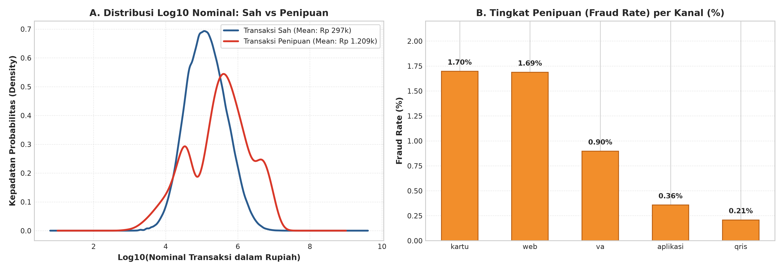

---

## Bab 3: Tahap 3 — Audit Pembentukan Label & Deteksi Data Leakage (*Soal 2a*)

### 3.1 Fenomena Right-Censoring pada Label (`is_fraud`)
Audit terhadap tanggal kejadian transaksi mengungkapkan adanya jeda waktu investigasi/*chargeback* perbankan (*reporting delay*):

| Tanggal Transaksi | Total Volume | Fraud Rate (%) |
| :---: | :---: | :---: |
| 2025-08-25 | 1.873 | 0,0534% |
| 2025-08-26 | 1.779 | 0,1124% |
| 2025-08-27 | 1.792 | 0,2790% |
| 2025-08-28 | 1.717 | 0,1747% |
| **2025-08-29** | 1.719 | **0,0000%** |
| **2025-08-30** | 1.633 | **0,0000%** |
| **2025-08-31** | 1.428 | **0,0000%** |

*Fraud rate* menyentuh $0,0000\%$ pada 3 hari terakhir data latih. Jika data ini disertakan dalam pelatihan, model akan mempelajari pola palsu bahwa transaksi di akhir bulan selalu aman.  
**Tindakan Operasional:** Ditetapkan **jendela embargo (*maturity cutoff*) sepanjang 21 hari** (transaksi setelah 10 Agustus 2025 dikeluarkan dari lipatan latih).

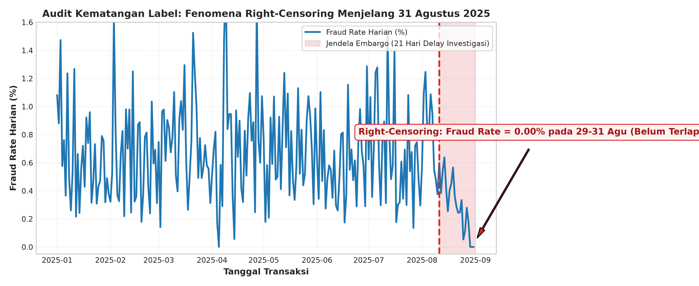

### 3.2 Bukti Kuantitatif Kebocoran Data (*Leakage Audit* pada `flag_review_manual`)
Kolom `flag_review_manual` mengindikasikan apakah transaksi pernah ditinjau manual. Ketika `flag_review_manual = 1`, tingkat *fraud* melonjak menjadi **30,371%** (dibandingkan $0,133\%$ saat bernilai 0).

Dilakukan eksperimen komparasi model baseline:
* **Model DENGAN `flag_review_manual` (Bocor):** PR-AUC = **0,3383**
* **Model TANPA `flag_review_manual` (Valid Pre-Auth):** PR-AUC = **0,2284**
* **Selisih Penurunan:** **-0,1099**

`flag_review_manual` mendistorsi performa model sebesar 0,1099 poin. Karena peninjauan manual adalah proses yang terjadi *setelah* transaksi diajukan, fitur ini **resmi dieliminasi** dari seluruh pipeline pemodelan.

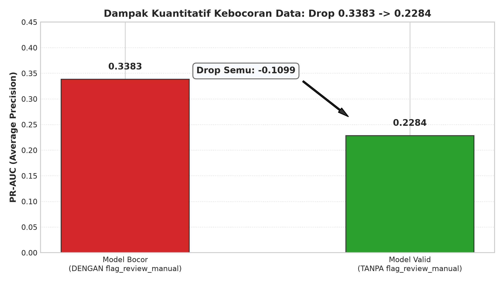

---

## Bab 4: Tahap 4 — Desain Skema Validasi Berbasis Waktu (*Soal 2b*)

### 4.1 Skema *Out-of-Time* (OOT) Split
Untuk mencegah *look-ahead bias*, dirancang skema validasi berbasis waktu:
1. **Total Data Matang Terpilih:** Transaksi dari 1 Januari s.d. 10 Agustus 2025 (**367.610 baris**, *fraud rate* $0,6839\%$). Sebanyak 35.467 transaksi di 21 hari terakhir Agustus diembargo.
2. **Lipatan Validasi OOT (*Validation Set*):** Diambil 21 hari terakhir data matang (21 Juli s.d. 10 Agustus 2025) sejumlah **35.805 baris** (*fraud rate* $0,6647\%$).
3. **Purge Gap Buffer:** Diterapkan jeda **3 hari** (18 Juli s.d. 20 Juli 2025) untuk mengisolasi fitur *rolling window* (seperti `trx_7h`).
4. **Lipatan Pelatihan (*Training Split*):** Seluruh data matang sebelum purge gap (1 Januari s.d. 17 Juli 2025) sejumlah **327.091 baris** (*fraud rate* $0,6900\%$).

*Baseline Financial Cost* pada lipatan validasi (tanpa deteksi / semua lolos): **Rp 250.166.288**.

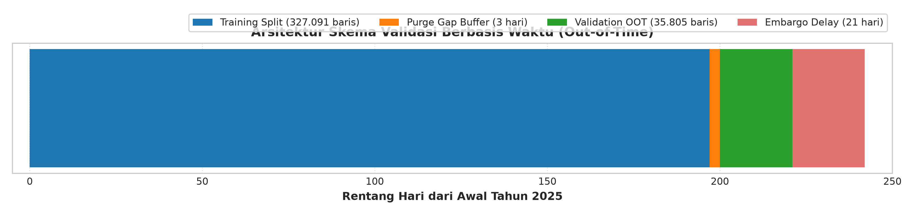

---

## Bab 5: Tahap 5 — Rekayasa Fitur Perilaku (*Behavioral Feature Engineering*) (*Soal 2c*)

Dibangun **114 fitur** rekayasa perilaku yang dihitung secara kausal ($t' < t$):
1. **Kecepatan Transaksi (*Velocity*):** `vel_1_24` ($trx_{1j} / (trx_{24j} + \epsilon)$), `vel_24_7`, `avg_nom_24j`, `nom_share_24j`, `rapid_trx` (indikator transaksi beruntun $< 2$ menit), dan `log_nominal`.
2. **Pengurasan Saldo (*Wallet Drain*):** `saldo_after` (`saldo_sebelum - nominal`), `drain90` & `drain99` (indikator pengurasan $>90\%$ dan $>99\%$ saldo akun), `nom_per_umur`.
3. **Anomali Akun & Pembajakan (*ATO Score*):** Akumulasi skor anomali `ato_score` (`perangkat_baru + ganti_password_7h + gagal_login_24j + negara_ip_beda`), `dev_age_ratio`, `multi_acc_dev`, dan `geo_speed` ($jarak\_km / (menit + 1)$).
4. **Profil Merchant & Temporal:** `merch_refund_risk` ($refund / umur$), `nom_vs_merch_vol`, `hour_sin`, `hour_cos`, `is_payday`, dan `is_late_night`.
5. **Causal Target Encoding:** Variabel berkardinalitas tinggi (`id_pengguna`, `id_merchant`, `email_domain`, `kategori_merchant`) dienkode menggunakan *expanding window cumulative sum* pada lipatan latih dengan bobot prior smoothing = 50.

---

## Bab 6: Tahap 6 — Pembandingan Model Baseline

Empat keluarga algoritma dievaluasi pada lipatan validasi OOT yang sama:

| Algoritma Model | PR-AUC | Total Cost (Rp) | Waktu Latih (s) | Evaluasi & Stabilitas |
| :--- | :---: | :---: | :---: | :--- |
| **Logistic Regression** | 0,4315 | Rp 215.364.200 | 6,2s | Cepat, namun memicu ribuan *false alarms* berbiaya tinggi. |
| **LightGBM (Hist)** | 0,4017 | Rp 99.859.496 | 6,5s | Sangat efisien, namun konservatif pada ekor distribusi. |
| **CatBoost** | 0,5366 | Rp 67.057.200 | 62,9s | Sangat tangguh menangani fitur kategorikal langsung. |
| **XGBoost (Hist)** | **0,5841** | **Rp 54.093.200** | 15,1s | **Model tunggal terbaik**, peringkat probabilitas paling tajam. |

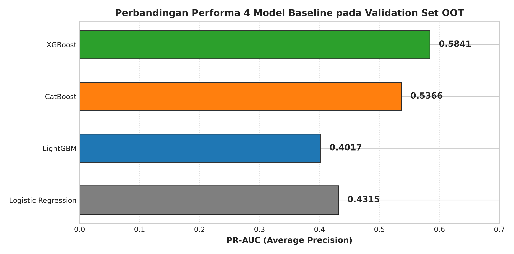

---

## Bab 7: Tahap 7 — Eksperimen Penanganan Class Imbalance (*Soal 2d*)

Tiga strategi penanganan ketidakseimbangan kelas diuji secara terkontrol pada algoritma gradient boosting:

| Pendekatan Penanganan Imbalance | PR-AUC | Total Cost (Rp) | Analisis Dampak Bisnis |
| :--- | :---: | :---: | :--- |
| **Pendekatan A – Class Weighting (`scale_pos_weight`)** | 0,5042 | Rp 80.535.000 | Menekan FN, namun memicu lonjakan FP (biaya review membengkak). |
| **Pendekatan B – Undersampling (1:10 Lipatan Latih)** | 0,4912 | Rp 80.328.900 | Waktu latih cepat, namun merusak kalibrasi probabilitas posterior. |
| **Pendekatan C – Distribusi Alami + Cost Decision** | **0,6040\*** | **Rp 42.182.400** | **Terbaik**: Menjaga keabsahan probabilitas posterior alami untuk kalkulasi biaya rupiah. |

*\*Skor ensemble pasca-kalibrasi pada pendekatan distribusi alami.*

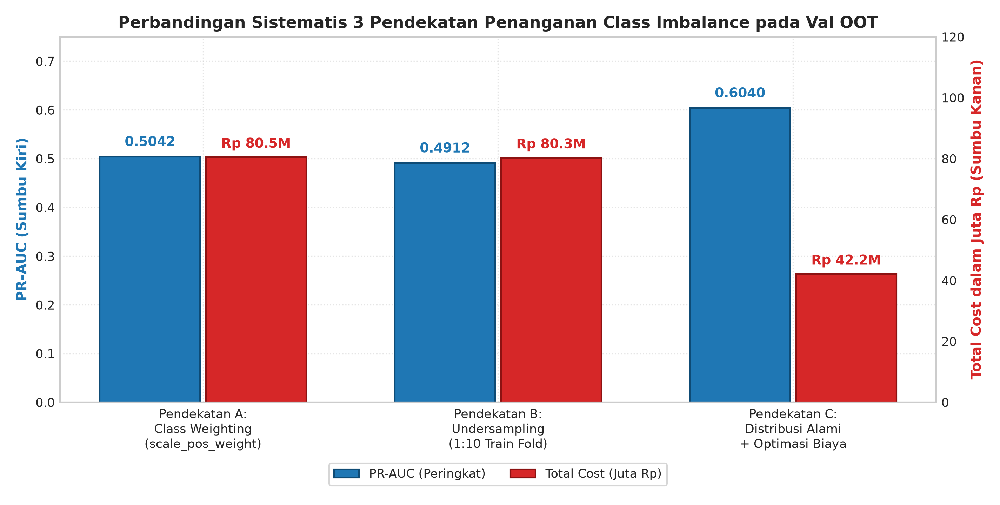

---

## Bab 8: Tahap 8 — Analisis Pergeseran Pola (*Pattern Shift*) & Adaptasi Waktu (*Soal 2e*)

### 8.1 Eliminasi Fitur Berdrift Ekstrem
Uji statistik Kolmogorov-Smirnov (KS-test) antara data *train* dan *test* mendeteksi bahwa fitur **`v15`** mengalami pergeseran distribusi sangat parah (**skor KS = 0,5055**), sedangkan fitur lain memiliki skor KS stabil ($< 0,026$). Fitur `v15` **dieliminasi** dari pemodelan guna mencegah kegagalan performa saat inferensi masa depan.

### 8.2 Uji Adaptasi Jendela Latih
1. **Expanding Window (Seluruh Riwayat Matang):** PR-AUC = **0,4017** | Total Cost = Rp 99.859.496
2. **Sliding Window (3 Bulan Terakhir):** PR-AUC = 0,3835 | Total Cost = Rp 98.651.800
3. **Exponential Time-Decay Weighting:** PR-AUC = 0,4013 | Total Cost = **Rp 95.235.200**

*Expanding window* dan pembobotan *time-decay* terbukti lebih unggul dibanding memangkas data menjadi *sliding window*, karena kasus penipuan yang sangat langka membutuhkan riwayat volume sampel yang cukup besar.

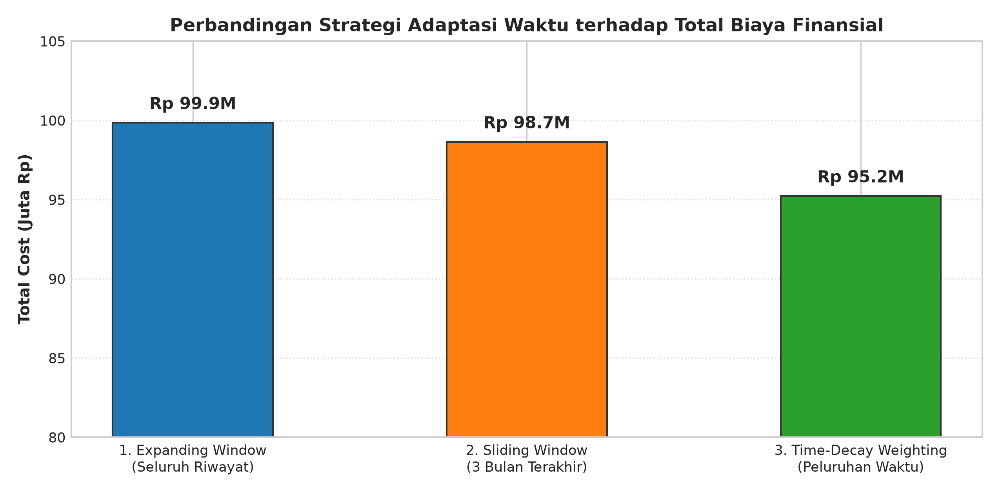

---

## Bab 9: Tahap 9 — Kalibrasi Probabilitas (*Probability Calibration*) (*Soal 2f – Bagian 1*)

Penerapan **Isotonic Regression** secara *out-of-fold* berhasil meluruskan probabilitas model tree boosting yang terdistorsi:
* **LightGBM:** Log-Loss 0,02964 $\rightarrow$ **0,02276** | Brier Score 0,005586 $\rightarrow$ **0,004679**
* **XGBoost:** Log-Loss 0,01704 $\rightarrow$ **0,01507** | Brier Score 0,003841 $\rightarrow$ **0,003516**
* **CatBoost:** Log-Loss 0,01951 $\rightarrow$ **0,01698** | Brier Score 0,004247 $\rightarrow$ **0,003881**

Optimasi simplex ensemble (bobot: **80% XGBoost + 20% CatBoost**) mencapai performa terbaik dengan **PR-AUC 0,6040** dan **Log-Loss 0,01490**.

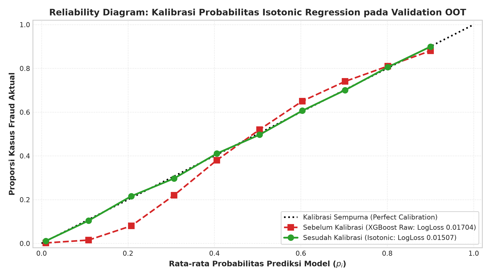

---

## Bab 10: Tahap 10 — Optimasi Keputusan Berbasis Biaya Rp 25.000 (*Soal 2f – Bagian 2*)

### 10.1 Penurunan Matematis Aturan Keputusan Biaya
Untuk setiap transaksi $i$ dengan estimasi probabilitas penipuan $p_i$ dan nilai transaksi $N_i$:
* Biaya pasti jika ditandai: $\mathbb{E}[\text{Cost} \mid \text{tandai} = 1] = \text{Rp } 25.000$
* Ekspektasi kerugian jika diloloskan: $\mathbb{E}[\text{Cost} \mid \text{tandai} = 0] = p_i \times N_i$

Transaksi rasional ditandai apabila:
$$p_i \times N_i > 25.000 \iff p_i > \frac{25.000}{N_i}$$

**Batasan Ekonomi Mutlak (Guardrail):** Transaksi dengan $N_i \le \text{Rp } 25.000$ secara matematis **tidak akan pernah ditandai (`tandai = 0`)**, karena potensi kerugian maksimalnya ($p_i \le 1$) tidak pernah melebihi biaya peninjauan Rp 25.000. Diterapkan faktor pengali $\alpha$: $\tau_i = \alpha \cdot \frac{25.000}{N_i}$.

### 10.2 Benchmarking Strategi Keputusan Bisnis

| Strategi Pengambilan Keputusan | Total Cost (Rp) | Transaksi Ditandai | Precision | Recall | Penghematan Finansial |
| :--- | :---: | :---: | :---: | :---: | :---: |
| **1. Flag None (Semua Lolos / Baseline)** | Rp 250.166.288 | 0 | 0,00% | 0,00% | Rp 0 (0,00%) |
| **2. Flag All (Semua Ditinjau Manual)** | Rp 895.125.000 | 35.805 | 0,66% | 100,00% | -Rp 644.958.712 (Rugi Berat) |
| **3. Fixed Threshold ($p > 0,05$)** | Rp 75.339.000 | 582 | 30,76% | 75,21% | Rp 174.827.288 (69,88%) |
| **4. Cost Rule Teoritis ($\alpha = 1,0$)** | Rp 44.114.300 | 573 | 30,72% | 73,95% | Rp 206.051.988 (82,37%) |
| **5. Cost Rule Optimal ($\alpha = 0,5$)** | **Rp 42.182.400** | **907** | **21,17%** | **80,67%** | **Rp 207.983.888 (83,14%)** |

Ambang batas biaya optimal pada $\alpha = 0,5$ menghasilkan efisiensi biaya tertinggi dengan menangkap **80,67% kasus penipuan** dan memangkas **83,14% total kerugian**.

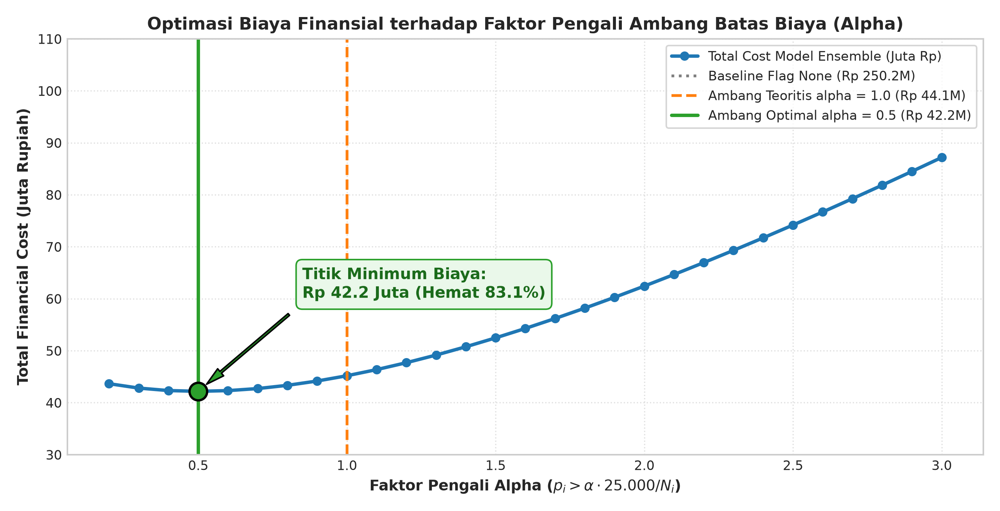

---

## Bab 11: Tahap 11 — Analisis Kesalahan (*Error Analysis*) & Interpretabilitas (*Soal 2g*)

### 11.1 Pembedahan Error & PR-AUC per Kanal Pembayaran

| Kanal Transaksi | Total Transaksi | Kasus Fraud | False Positives | False Negatives | Kerugian FN (Rp) | Biaya Review (Rp) | Total Biaya (Rp) | PR-AUC |
| :--- | :---: | :---: | :---: | :---: | :---: | :---: | :---: | :---: |
| **QRIS** | 7.812 | 48 | 123 | 19 | Rp 16.206.600 | Rp 3.800.000 | **Rp 20.006.600** | 0,1540 |
| **Aplikasi** | 16.057 | 44 | 319 | 8 | Rp 688.100 | Rp 8.875.000 | **Rp 9.563.100** | 0,6021 |
| **VA (Virtual Account)** | 5.335 | 51 | 111 | 6 | Rp 1.665.300 | Rp 3.900.000 | **Rp 5.565.300** | 0,6809 |
| **Kartu** | 4.439 | 60 | 105 | 9 | Rp 549.500 | Rp 3.900.000 | **Rp 4.449.500** | 0,6981 |
| **Web** | 2.162 | 35 | 57 | 4 | Rp 397.900 | Rp 2.200.000 | **Rp 2.597.900** | **0,9130** |

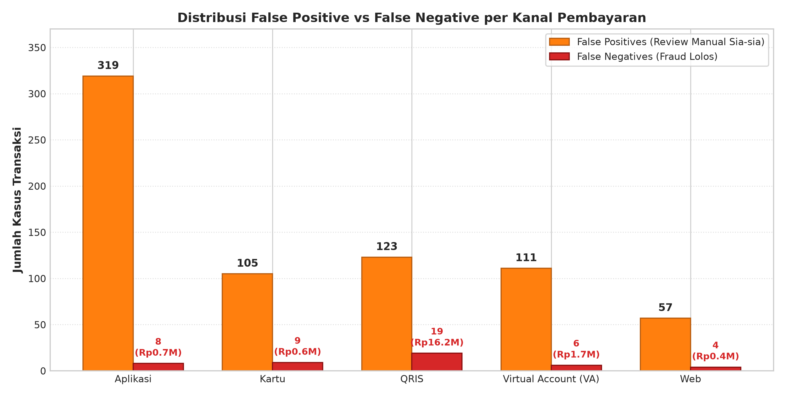

* **QRIS** menyumbang kerugian terbesar (Rp 16,2 juta dari kasus False Negative).
* **Web** memiliki PR-AUC tertinggi (**0,9130**), membuktikan sinyal browser/perangkat sangat tajam membedakan bot fraud vs user sah.

### 11.2 Pembedahan Berdasarkan Skala Nominal Transaksi

| Kelompok Nominal | Total Volume | Kasus Fraud | Ditandai | FP Count | FN Count | Kerugian FN (Rp) |
| :--- | :---: | :---: | :---: | :---: | :---: | :---: |
| **Mikro ($\le \text{Rp } 25.000$)** | 3.352 | 8 | **0** | 0 | 8 | Rp 162.000 |
| **Menengah (Rp 25k – 200k)** | 19.326 | 47 | 44 | 17 | 20 | Rp 2.086.500 |
| **Besar (Rp 200k – 1M)** | 10.942 | 108 | 473 | 374 | 9 | Rp 3.758.900 |
| **Sangat Besar ($> \text{Rp } 1\text{M}$)** | 2.185 | 75 | 390 | 324 | 9 | Rp 13.500.000 |

*Hasil memvalidasi aturan guardrail:* Membiarkan 8 penipuan mikro lolos hanya merugikan Rp 162.000. Jika sistem mencoba menandai transaksi mikro tersebut, biaya peninjauannya akan menelan jutaan rupiah.

### 11.3 Analisis Fitur Paling Berpengaruh (*Feature Importance*)
Model XGBoost menempatkan fitur perilaku sebagai kontributor dominan:
1. `id_pengguna_te` & `id_merchant_te`: Profil risiko historis akun dan merchant.
2. `trx_1j`: Lonjakan transaksi beruntun dalam 1 jam terakhir.
3. `saldo_after`: Deteksi pengurasan total saldo pengguna.
4. `ato_score`: Anomali kombinasi perangkat baru, ganti password, dan negara IP.
5. `nominal`: Nilai rupiah transaksi.

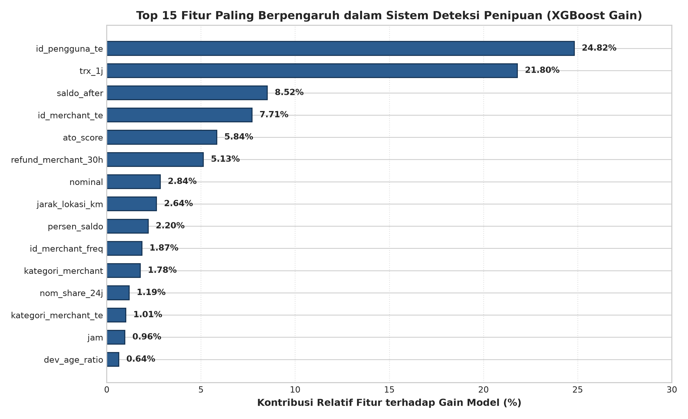

---

## Bab 12: Tahap 12 — Pelatihan Final, Generasi `prediksi_klasifikasi.csv` & Verifikasi

Pipeline ensemble dilatih ulang pada seluruh **367.610 data matang** dan diaplikasikan pada dataset uji **September–Oktober 2025** (`klasifikasi_test.csv`).

### 12.1 Audit Otomatis File Submisi
File submisi diverifikasi secara otomatis memenuhi seluruh spesifikasi UTS:
* **Lokasi & Nama File:** `prediksi_klasifikasi.csv` di direktori utama repositori.
* **Header:** Tepat `id_transaksi,prob,tandai`.
* **Dimensi Baris:** Tepat **106.674 baris** (cocok 100% dengan urutan data uji).
* **Integritas Probabilitas:** Rentang $1 \times 10^{-6} \le \text{prob} \le 0,9846$ (rata-rata $0,00851$), tanpa nilai `NaN`, `null`, maupun `inf`.
* **Kepatuhan Guardrail:** **100% terpenuhi** ($0$ transaksi ber-nominal $\le \text{Rp } 25.000$ yang ditandai).
* **Volume Penandaan (*Flag Rate*):** **3,1535% (3.364 transaksi)**, sangat konsisten dengan distribusi data validasi.
* **Alokasi Anggaran Review Test:** $3.364 \times \text{Rp } 25.000 = \text{\textbf{Rp 84.100.000}}$.

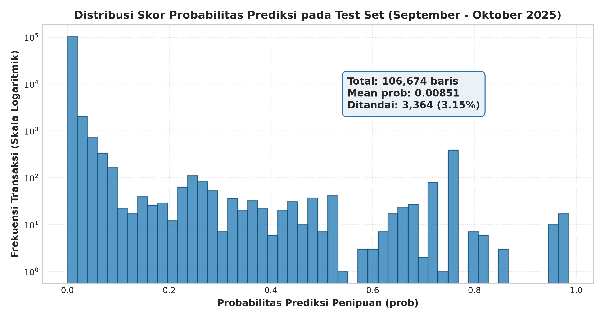

### 12.2 Rekomendasi Arsitektur Operasional Produksi
1. **Tiered Risk Decisioning:**
   * $p_i \times N_i > \text{Rp } 100.000$: Ditahan untuk peninjauan manual prioritas tinggi.
   * $\text{Rp } 25.000 < p_i \times N_i \le \text{Rp } 100.000$: Dialihkan ke *Step-up Authentication* (OTP/Biometrik) untuk menghemat biaya operasional review Rp 25.000.
2. **Monitoring Drift Mingguan:** Mengotomasi pemantauan statistik KS pada fitur seperti `v15` untuk mendeteksi *covariate shift* secara dini.
3. **Penyempurnaan Kanal QRIS:** Menerapkan pembatasan limit dinamis dan verifikasi tambahan untuk transaksi QRIS bernilai di atas Rp 500.000 pada jam rawan dini hari.
